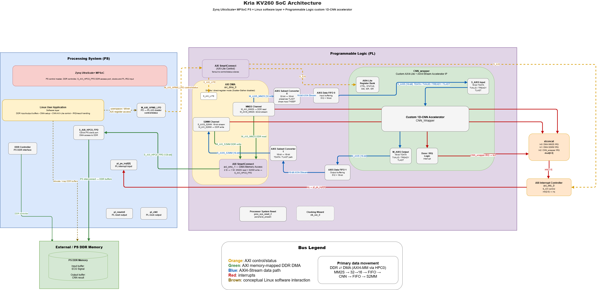
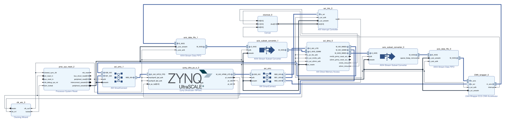

# System overview

## 1. The problem

Classify one heartbeat into one of five AAMI classes from a 187-sample ECG segment.

| Code | Class | Share of the MIT-BIH test set |
| :--- | :--- | ---: |
| N | Normal / non-ectopic | 82.76 % |
| S | Supraventricular ectopic | 2.54 % |
| V | Ventricular ectopic | 6.61 % |
| F | Fusion | 0.74 % |
| Q | Unknown / paced | 7.35 % |

A beat arrives every ~0.6–1.0 s at a normal heart rate; the accelerator classifies one in
**1.041 ms**. Compute throughput is therefore not the binding constraint — determinism,
numerical exactness and fitting the weights on-chip are.

## 2. How the work is divided


| Layer | Runs on | Responsibility |
| :--- | :--- | :--- |
| Application | Cortex-A53, Linux user space | Qt UI, beat segmentation, engine selection, abnormal-event review |
| Driver | Linux kernel + user space | `pl_dmabuf` CMA buffer, AXI DMA register sequence, completion interrupt |
| PS | Zynq UltraScale+ | DDR, AXI interconnect, GIC |
| **PL** | **100 MHz fabric** | **The whole network: 6 conv layers, 2 max-pools, global max-pool, 3 linear layers** |
| Memory | PS DDR | Input frame and output logits |

No part of the network runs on the processor. The PS stages 748 bytes, writes five registers,
and reads back 10 bytes.

## 3. One beat, end to end



1. The application obtains a beat — ESP32 over serial, a file, or the built-in simulator — as
   **187 signed Q8.8 samples**.
2. It writes them into the coherent CMA buffer, one sample per 32-bit word, at offset `0x0000`
   (748 bytes).
3. `dsb sy`. The buffer is Normal non-cacheable, which on arm64 is *weakly ordered*, so the
   barrier is what stops the DMA reading a partly-written frame.
4. It arms the **S2MM** (receive) channel first, pointing at offset `0x1000`.
5. It starts the accelerator over AXI4-Lite: `CTRL` bit 0.
6. It writes the **MM2S `LENGTH`** register **last** — that write launches the transfer.
7. The DMA reads the frame; a subset converter narrows 32-bit words to the 16-bit stream; a FIFO
   absorbs jitter; `CNN_wrapper` consumes `TVALID`/`TREADY`/`TLAST` beats.
8. The accelerator streams the network: conv1 → conv2 → pool1 → conv3 → conv4 → pool2 → conv5 →
   conv6 → global max-pool → fc1 → fc2 → fc3.
9. It emits **5 logits**, 16 bits each, `TLAST` on the fifth. A FIFO and a 16→32 converter feed
   them to the DMA's S2MM channel, which writes them to DDR.
10. The accelerator raises `done`; the AXI interrupt controller forwards it to `pl_ps_irq0`.
11. `dsb sy`, then the application reads 10 bytes and takes the argmax.

About **104 000 clocks at 100 MHz**. Measured on the board: 1.037–1.041 ms, with a min-to-p99
spread of 0.000 ms.

Interface detail is in [02_rtl_microarchitecture.md](02_rtl_microarchitecture.md) §5–§7.

## 4. What is in the fabric



| Block | Role |
| :--- | :--- |
| `zynq_ultra_ps_e_0` | PS. `M_AXI_HPM0_LPD` for control, `S_AXI_HPC0_FPD` (128-bit) for DMA access to DDR |
| `axi_dma_0` | AXI DMA, simple mode, scatter-gather disabled, 32-bit stream |
| `axis_subset_converter_0/1` | 32↔16-bit conversion on each stream direction |
| `axis_data_fifo_0/1` | 512 × 16-bit buffering either side of the accelerator |
| `CNN_wrapper_0` | The custom accelerator IP |
| `axi_smc`, `axi_smc_1` | SmartConnect for control fan-out and for DMA memory access |
| `axi_intc_0`, `xlconcat_0` | Three interrupt sources (MM2S done, S2MM done, CNN done) into one PS IRQ |
| `clk_wiz_0`, `proc_sys_reset_2` | One 100 MHz PL clock domain and its synchronised reset |

Sources: [`../05_fpga/01_PS_PL_block_design/`](../05_fpga/01_PS_PL_block_design/).

**One clock domain.** An earlier revision had three Clocking Wizard outputs, two driving nothing
but reset synchronisers, and a SmartConnect configured with two clocks on interfaces that shared
one. That second domain was never constrained, so thousands of endpoints went untimed while a
bitstream was still produced. The study is in
[`../05_fpga/03_timing_closure_study/`](../05_fpga/03_timing_closure_study/) and the analysis in
[04_fpga_implementation.md](04_fpga_implementation.md) §4.

## 5. Three inference engines, one application

The Qt application exposes three interchangeable backends so the PL can be compared against
something on identical input:

| Engine | What it is | Per-beat latency |
| :--- | :--- | ---: |
| **RTL** | The PL accelerator, via AXI DMA | **1.04 ms** |
| CPU | The FP32 reference CNN, NumPy, in a long-lived `python3` worker | ~90 ms |
| DPU | Vitis AI `.xmodel` on the KV260 DPU | — |

Every engine receives **the same Q8.8 bits**, so a disagreement between them is arithmetic, never
a difference in input. Only one engine runs at a time; switching starts a clean session.

The PL is about **86×** faster than the CPU backend. That baseline is a clean NumPy transcription
on one A53 core with no OpenBLAS, no MKL, and three cores idle — a fair *reference* comparison,
not a comparison against optimised CPU code. See
[05_results_and_known_issues.md](05_results_and_known_issues.md) §3.

## 6. How correctness was established

Each level is checked against the same fixed-point golden reference, and each one can be made to
fail:

```
Python float model
      |  quantize
Python fixed-point model  -----------------+
      |  golden vectors                    |
RTL simulation (26 benches)                |  all compared against
      |                                    |  the same golden logits
Block-design simulation (Zynq VIP + DMA)   |
      |                                    |
Post-synthesis netlist simulation          |
      |                                    |
KV260 silicon  ---------------------------+
```

The netlist level is not ceremonial — it is the level that caught the one real defect in this
project. See [03_verification_strategy.md](03_verification_strategy.md) §5.

## 7. Headline results

| | Value | Evidence |
| :--- | ---: | :--- |
| Post-route WNS / WHS @100 MHz | **+1.733 ns** / +0.012 ns | [`../05_fpga/02_synthesis_implementation_results/02_post_route_implementation/00_headline.txt`](../05_fpga/02_synthesis_implementation_results/02_post_route_implementation/00_headline.txt) |
| Reference beats bit-exact on silicon | **5/5** (25/25 logits) | [`../04_verification/06_verification_evidence/03_board_silicon_results/board_golden_check_v3.txt`](../04_verification/06_verification_evidence/03_board_silicon_results/board_golden_check_v3.txt) |
| Accuracy / macro-F1, 21 892 beats | **98.16 %** / **0.8902** | [`../04_verification/06_verification_evidence/03_board_silicon_results/board_fullset_v3.txt`](../04_verification/06_verification_evidence/03_board_silicon_results/board_fullset_v3.txt) |
| Latency | 1.041 ms/beat | same |
| RTL regression | 26/26 PASS | [`../04_verification/03_automated_regression/RESULTS.md`](../04_verification/03_automated_regression/RESULTS.md) |

Quote **macro-F1, not accuracy** — class N is 82.76 % of the test set, so answering "N" to
everything already scores above 82 %. Full caveats:
[05_results_and_known_issues.md](05_results_and_known_issues.md).
