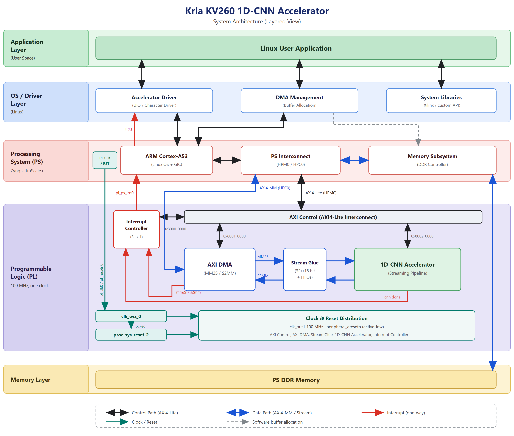

# 01_docs — Engineering documentation

The design documents, the architecture figures, and the provenance record.

Each document below is aimed at one of the three engineering roles this project covers, but they
read in sequence.

| Document | Primary reader | What it answers |
| :--- | :--- | :--- |
| [01_system_overview.md](01_system_overview.md) | all | What the system does, how PS and PL divide the work, how one heartbeat flows end to end |
| [02_rtl_microarchitecture.md](02_rtl_microarchitecture.md) | **RTL design** | Layer topology, parallel engines, the frozen arithmetic contract, AXI interfaces, register and memory map |
| [03_verification_strategy.md](03_verification_strategy.md) | **Design verification** | The verification pyramid, what each level actually proves, the negative controls, the coverage gaps |
| [04_fpga_implementation.md](04_fpga_implementation.md) | **FPGA** | Build flow, timing closure, resource budget, the clocking defect, KV260 bring-up and deployment |
| [05_results_and_known_issues.md](05_results_and_known_issues.md) | all | Every measured number with the evidence file that backs it, and every caveat worth knowing before quoting one |

## Figures



| Figure | Shows |
| :--- | :--- |
| [figure/system_layered_architecture.png](figure/system_layered_architecture.png) | Application, driver, PS, PL and memory layers, with the AXI address map |
| [figure/ps_pl_dataflow.png](figure/ps_pl_dataflow.png) | Detailed PS–PL dataflow: every bus, width converter and interrupt labelled |
| [figure/system_bd_single_clock.png](figure/system_bd_single_clock.png) | The Vivado block design as shipped — one PL clock domain |
| [figure/demo_setup.jpg](figure/demo_setup.jpg) | The assembled system running: KV260, ESP32 serial source, Qt application classifying live |

## Provenance

[path_mapping.csv](path_mapping.csv) records every file carried into this repository: its former
path, its path here, and the SHA-256 before and after the move. Use it to prove a file is
unmodified, or to trace an artifact back to the tree that produced it.

```bash
grep "conv6_weight_p32_k3_b0.hex" 01_docs/path_mapping.csv
```
