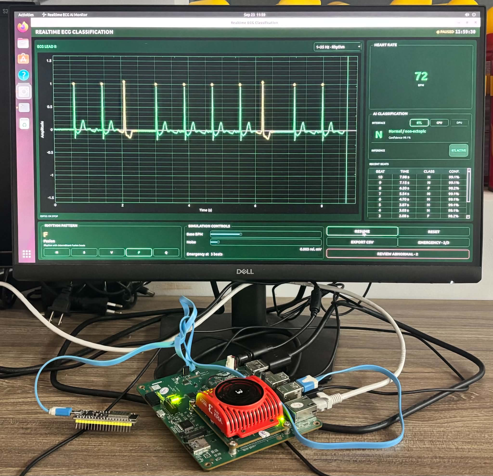

# ECG 1D-CNN on Kria KV260 | RTL · Verification · FPGA

A custom streaming **1D-CNN accelerator** built in RTL, closed at 100 MHz on the KV260 programmable logic, verified bit-exact from golden model to silicon, and driven by a Qt application that classifies heartbeats live.



## System Architecture


| Area | Key contents |
|---|---|
| [01_docs](01_docs/) | [Architecture figures](01_docs/01_system_architecture/) and file provenance |
| [02_model](02_model/) | FP32, fixed-point and hardware-aligned reference models |
| [03_rtl](03_rtl/) | [CNN IP RTL](03_rtl/01_CNN_accelerator_IP/src/), weight ROMs and IP build scripts |
| [04_verification](04_verification/) | Unit/integration benches, [regression](04_verification/03_automated_regression/) and post-synthesis verification |
| [05_fpga](05_fpga/) | [PS–PL block design](05_fpga/01_PS_PL_block_design/), timing/implementation reports, KV260 deployment |
| [06_software](06_software/) | Linux DMA driver, board host utilities and Qt application |

| Recorded result | Value |
|---|---|
| PL frequency / post-route WNS | 100 MHz / **+1.733 ns** |
| Implementation | 23,987 LUT · 39,800 FF · 130/144 BRAM · 169 DSP |
| RTL verification | 26/26 benches PASS (**historical record**) |
| On-board classification | 98.16% accuracy · 0.8902 macro-F1 · 21,892 beats |
| Mean inference latency | 1.041 ms/beat (**historical record**) |


## RTL Design Engineering

Explore [streaming CNN datapaths and fixed-point RTL](03_rtl/01_CNN_accelerator_IP/src/).


### CNN control registers

`CNN_wrapper` exposes a 32-bit AXI4-Lite register interface:

| Offset | Register | Purpose |
| ---: | --- | --- |
| `0x00` | `CTRL` | Bit 0 starts an inference; bit 1 clears done/IRQ state |
| `0x04` | `STATUS` | Done, idle, and busy status |
| `0x08` | `GIE` | Global interrupt enable |
| `0x0C` | `IER` | Done-interrupt enable |
| `0x10` | `ISR` | Done-interrupt status; write 1 to clear |

The stream interface implements the AXI4-Stream protocol for framed ECG transfers. The wrapper interrupt is routed to the AXI interrupt controller and
then to the processing system.

## Design Verification Engineering

Explore [self-checking benches](04_verification/01_RTL_unit_testbenches/), [regression](04_verification/03_automated_regression/) and [golden vectors](04_verification/05_golden_test_vectors/).

The automatic scripts to verify the design.

```bash
python3 04_verification/03_automated_regression/run_regression.py --suite smoke --dry-run
python3 04_verification/03_automated_regression/run_regression.py --suite smoke
python3 04_verification/03_automated_regression/verify_weights.py
```

*Results are recorded development measurements, not a fresh Vivado build or board revalidation of this folder migration.*


## FPGA Engineering

Explore [Zynq PS–PL architecture](05_fpga/01_PS_PL_block_design/), [routed implementation evidence](05_fpga/02_synthesis_implementation_results/) and [deployment files](05_fpga/04_KV260_deployment/).

