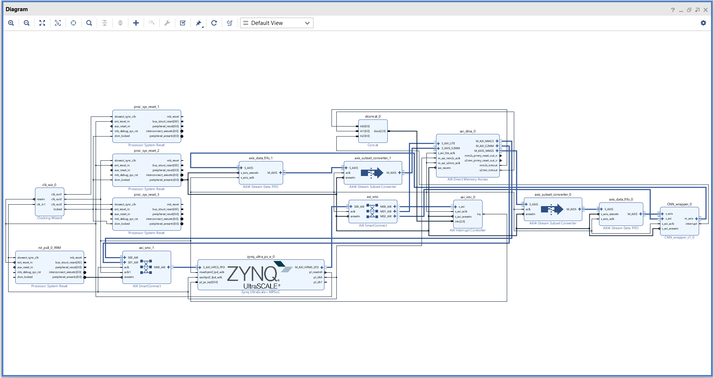

# FPGA ECG System

Hardware platform for an ECG inference accelerator on the AMD/Xilinx Kria
KV260. The design combines a Zynq UltraScale+ MPSoC processing system with a
custom streaming 1D-CNN IP, AXI4-Stream data movement, AXI DMA, and interrupt
handling.

## Block design



The block design contains:

- Zynq UltraScale+ MPSoC processing system for software control.
- AXI DMA for high-throughput PS-to-PL and PL-to-PS transfers.
- AXI4-Stream FIFOs and subset converters around the CNN data path.
- AXI SmartConnect and an AXI interrupt controller.
- `CNN_wrapper`, a custom AXI4-Lite and AXI4-Stream interface for the ECG CNN.
- Clock generation and reset synchronization for the processing and stream
  domains.

## Data path

```text
PS memory
   │
   ▼
AXI DMA ──► AXI4-Stream FIFO ──► CNN_wrapper ──► AXI4-Stream FIFO ──► AXI DMA
   ▲                                                                    │
   └────────────────────────── interrupt/status ◄───────────────────────┘
```

The accelerator uses 16-bit AXI4-Stream samples. The CNN RTL implements the
streaming convolution, ReLU, max-pooling, global max-pooling, and linear-layer
stages used by the ECG classifier.

## Repository layout

| Path | Description |
| --- | --- |
| `kv260_hardware_platform.xpr` | Vivado 2024.2 project for the KV260 SOM |
| `kv260_hardware_platform.srcs/` | Block design and IP configuration sources |
| `reference/` | Legacy local CNN IP reference (not used by the current design) |
| `assets/kv260_ecg_block_design.png` | Vivado block-design overview |

Vivado-generated cache, synthesis, implementation, simulation, and output
directories are intentionally excluded from version control.

## Requirements

- AMD/Xilinx Vivado 2024.2 or a compatible Vivado release.
- Kria KV260 SOM board files installed in Vivado.
- Target part: `xck26-sfvc784-2LV-c`.
- Board part: `xilinx.com:kv260_som:part0:1.4`.

## Open and build

1. Open `kv260_hardware_platform.xpr` in Vivado.
2. Confirm that the project IP repository includes
   `D:/FPGA_cc/ip_repo/CNN_wrapper_v1_6`.
3. Open the `system` block design and run **Validate Design**.
4. Generate output products, then run synthesis and implementation.
5. Generate the bitstream and export the hardware platform as required by the
   software application.

The project is configured to use the versioned `CNN_wrapper` v1.6 package in
`D:/FPGA_cc/ip_repo`. Its synthesis pre-hook stages the required CNN model
files before each build.

## CNN control registers

`CNN_wrapper` exposes a 32-bit AXI4-Lite register interface:

| Offset | Register | Purpose |
| ---: | --- | --- |
| `0x00` | `CTRL` | Bit 0 starts an inference; bit 1 clears done/IRQ state |
| `0x04` | `STATUS` | Done, idle, and busy status |
| `0x08` | `GIE` | Global interrupt enable |
| `0x0C` | `IER` | Done-interrupt enable |
| `0x10` | `ISR` | Done-interrupt status; write 1 to clear |

The stream interfaces use `TVALID`, `TREADY`, and `TLAST` for framed ECG
transfers. The wrapper interrupt is routed to the AXI interrupt controller and
then to the processing system.

## Notes

This repository contains the hardware platform and custom CNN IP. A software
application is not included; PS-side software should configure the CNN control
registers, submit input buffers through the AXI DMA, and consume the returned
classification data.
